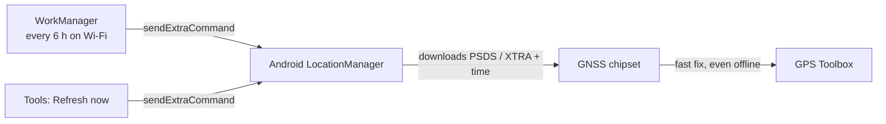
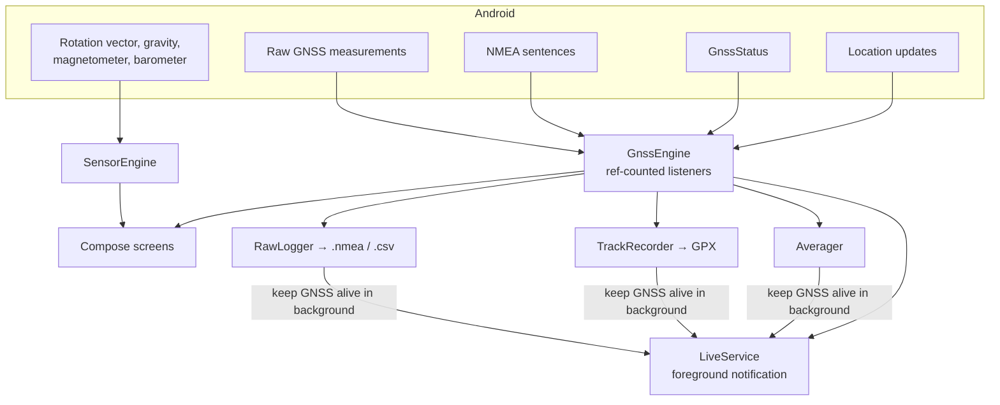
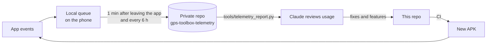

# GPS Toolbox

A modern, ad-free replacement for "GPS Status & Toolbox": precise GNSS readouts, a sky plot,
position averaging and a set of field tools. Kotlin + Jetpack Compose, Android 11+.

## Install

Every push to `main` is built by GitHub Actions and published under
[Releases](../../releases/latest) as `gps-toolbox-<build>.apk`.

1. Open the latest release on your phone and download the APK.
2. Allow your browser to install unknown apps when Android asks.
3. Updates install over the previous version (the build number is the version code).

Tip: [Obtainium](https://github.com/ImranR98/Obtainium) can watch this repo's releases and update the app automatically.

## Features

| Screen | What it shows |
| --- | --- |
| **Now** | Position in DD / DDM / DMS / UTM / MGRS, horizontal and vertical accuracy, fix age and rate, speed, MSL altitude, GPS course and compass heading, PDOP/HDOP/VDOP, satellites used per constellation, dual-band (L1+L5) status |
| **Sky** | Sky plot coloured by constellation (north-up or heading-up), C/N₀ bars per band, full satellite table with elevation, azimuth, L1/L5 signal and ephemeris status |
| **Accuracy** | Position averaging with fix scatter, CEP50 / R95 circles, drift, standard error, 10-minute accuracy history, CSV export |
| **Tools** | Live notification, compass (true/magnetic), bubble level, waypoints with a radar back to them, GPX track recording, NMEA and raw-measurement logging, sensor readouts, A-GNSS refresh, cold-start / time-to-first-fix test |

## Background assistance data (A-GNSS)

The app cannot download satellite orbits itself. It asks Android's location stack to fetch
predicted orbits (PSDS / XTRA) and network time. A WorkManager job does this every few hours
(default 6 h, Wi-Fi only), so the data is fresh when you later use the app without reception.



## How data flows through the app



## Usage data (opt-in telemetry)

Instead of writing feedback, the app can record how it is used and upload that to a **private**
GitHub repository you own. The upload token stays on the phone (excluded from backups); it is
never in this repo or the APK.

**Recorded:** screens and time spent, tools used, settings changes, a GNSS quality snapshot once a
minute while GNSS runs (accuracy, satellites per system, bands, C/N₀, DOP), A-GNSS refreshes,
time to first fix with the age of the assistance data, errors and crashes, device and chipset model.
**Never recorded:** coordinates, waypoint names, file contents.



### Setup (once)

1. On GitHub, create a **private** repository, e.g. `gps-toolbox-telemetry`, and tick *Add a README file*.
2. Create a [fine-grained personal access token](https://github.com/settings/personal-access-tokens/new):
   *Repository access* → *Only select repositories* → the telemetry repo; *Permissions* →
   *Contents: Read and write*. Nothing else.
3. In the app: *Settings* → *Usage data* → turn on, enter `owner/repo` and paste the token → *Save* → *Upload now*.

Files land in `events/<yyyy-mm-dd>/<device>-<timestamp>.jsonl`, one JSON event per line.
Summarise them with:

```powershell
python tools\telemetry_report.py ..\gps-toolbox-telemetry --days 14
```

## Build locally

Open the project in Android Studio (JDK 17) or run, in PowerShell:

```powershell
.\gradlew.bat testReleaseUnitTest assembleRelease
```

Unit tests cover the coordinate conversions (checked against pyproj and the `mgrs` reference
library), NMEA parsing and GPX output.

## Signing

Without secrets, CI signs with the committed `ci/debug.keystore`, which keeps updates installable.
To use a private key instead, add these repository secrets: `SIGNING_KEYSTORE_B64` (base64 of a
`.jks`), `SIGNING_STORE_PASSWORD`, `SIGNING_KEY_ALIAS`, `SIGNING_KEY_PASSWORD`. Switching keys
requires uninstalling the app once.
